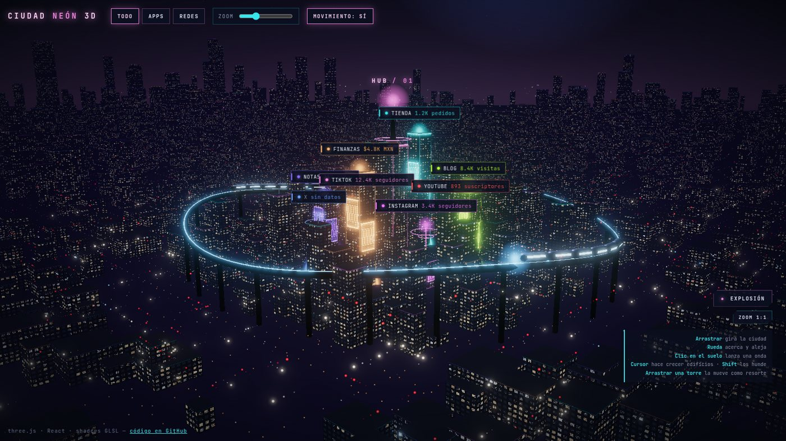
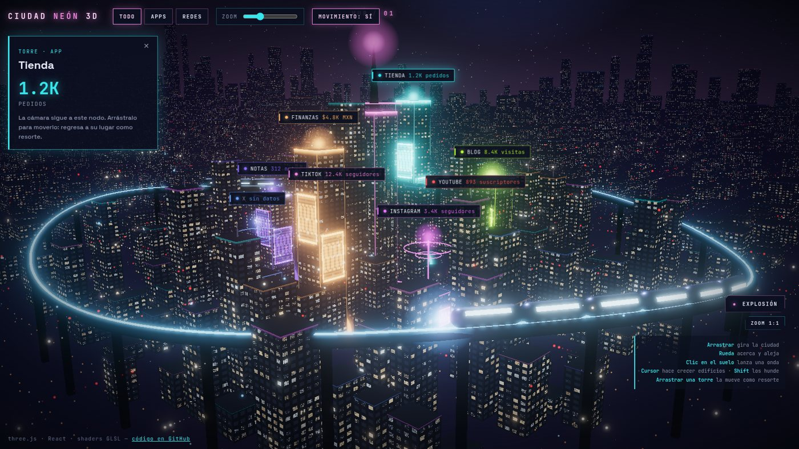
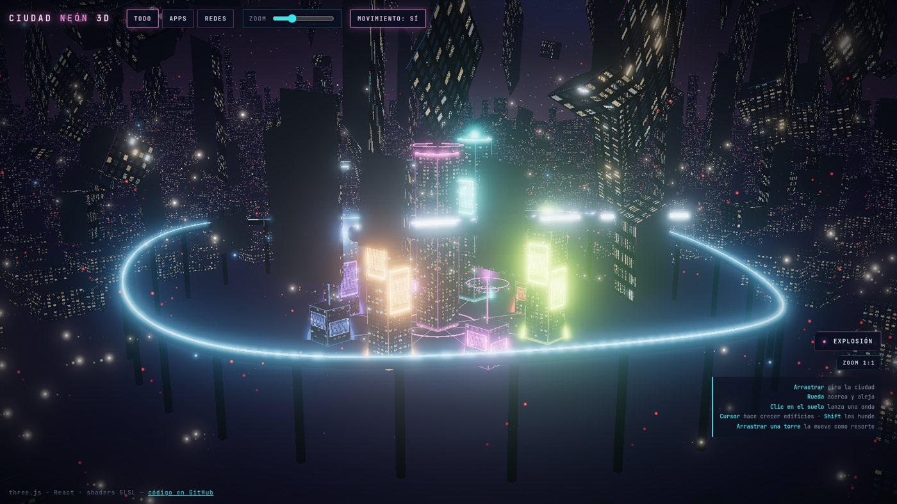

# Ciudad Neón 3D

Una ciudad cyberpunk en 3D, interactiva, hecha con **three.js**, **React** y **shaders GLSL** propios. Cada torre o antena de la ciudad representa un dato (una app, una red social…) con su valor en una etiqueta. Alrededor hay una megaciudad viva: miles de edificios con ventanas que se encienden, tráfico aéreo, un tren maglev, lluvia de partículas y niebla.



Es una réplica, lista para usar, de la skin **"Ciudad"** del panel personal (hub) donde veo mis redes y mis apps. Aquí trae datos de ejemplo para que cualquiera la pueda correr, estudiar y adaptar.

| Al elegir una torre | Botón "Explosión" |
| --- | --- |
|  |  |

---

## Qué puedes hacer

| Acción | Qué pasa |
| --- | --- |
| **Arrastrar** el fondo | Gira la ciudad (sin arrastrar, rota sola despacio) |
| **Rueda** del mouse | Acerca y aleja |
| **Mover el cursor** | Los edificios bajo el cursor crecen y brillan; con **Shift** se hunden |
| **Clic en el suelo** | Lanza una onda que levanta edificios, autos y partículas a su paso |
| **Clic en una torre** o en su etiqueta | La cámara se acerca a ella y se abre su panel |
| **Arrastrar una torre** | La mueves por la ciudad; al soltarla regresa a su lugar como un resorte |
| **Explosión** | Los edificios salen volando, giran y vuelven a su lugar |
| **Filtros** Todo / Apps / Redes | Atenúan los nodos que no son de ese tipo |
| **Movimiento** | Pausa o reanuda tráfico, tren, partículas y rotación |

Los números de las etiquetas cambian solos cada pocos segundos, para mostrar que la ciudad se actualiza **sin volver a armar la escena**.

---

## Correrlo

Necesitas **Node.js 20 o más nuevo**.

```bash
git clone https://github.com/Arzival/ciudad-neon-3d.git
cd ciudad-neon-3d
npm install
npm run dev
```

Abre la dirección que imprime Vite (normalmente `http://localhost:5173`).

Para generar la versión final:

```bash
npm run build     # deja todo en dist/
npm run preview   # la sirve para probarla
```

La configuración usa `base: "./"`, así que `dist/` funciona igual en GitHub Pages, Netlify o cualquier carpeta de un servidor.

---

## Usarla con tus propios datos

Todo el mundo 3D vive en un solo componente: `src/city/CityWorld.tsx`. Recibe la lista de nodos y unas cuantas opciones:

```tsx
import CityWorld, { type CityWorldNode } from "./city/CityWorld";

const nodes: CityWorldNode[] = [
  // type "app" = torre (su altura sale de `height`); type "social" = antena
  { id: "tienda", name: "Tienda", type: "app", color: "#37e5ec", value: "1.2K", unit: "pedidos", hasData: true, x: -73, y: -175, height: 110 },
  { id: "tiktok", name: "TikTok", type: "social", color: "#f186df", value: "12.3K", unit: "seguidores", hasData: true, x: -175, y: -73, height: 40 },
];

<CityWorld
  nodes={nodes}
  selectedId={selectedId}   // id del nodo enfocado o null
  filter="all"              // "all" | "app" | "social"
  zoom={1}                  // multiplicador de zoom (además de la rueda)
  motion={true}             // false pausa la animación de fondo
  onSelect={(id) => setSelectedId(id)}
  centerLabel="HUB"         // texto de la torre central (opcional)
/>
```

| Campo del nodo | Para qué sirve |
| --- | --- |
| `id` | Identificador único |
| `name`, `value`, `unit` | Lo que se lee en la etiqueta: `TIENDA 1.2K pedidos` |
| `type` | `"app"` se dibuja como torre; `"social"` como antena con anillos que laten |
| `color` | Neón de la torre, sus hologramas, su halo y su línea de datos al centro |
| `hasData` | Si es `false`, el nodo se ve más apagado y dice "sin datos" |
| `x`, `y` | Posición en un plano de ±250 (el centro es la torre principal). Conviene repartirlos en anillo para que las etiquetas no se encimen |
| `height` | Altura de la torre (solo apps) |

Si cambian los **valores** (`value`, `hasData`, el filtro, la selección…), la ciudad lo refleja al instante. Si cambia la **lista** de nodos (agregas o quitas uno), cambia la `key` del componente para que se vuelva a armar.

---

## Cómo está hecha

La idea central: **la escena se arma una sola vez** y todo lo que se mueve lo calcula la tarjeta de video en shaders. React solo le pasa el estado más reciente por una referencia (`stateRef`), así que actualizar datos no reconstruye nada.

### 1. Miles de edificios en dos llamadas de dibujo
Hay un par de cientos de edificios en el centro "jugable" y unos 4,000 hacia el horizonte. Todos son el mismo cubo (con la base en el suelo) dibujado con `THREE.InstancedMesh`: un solo objeto por grupo, con la posición y el tamaño de cada copia en una matriz. Así la GPU dibuja miles de edificios casi al costo de uno.

Su distribución sale de un generador aleatorio con semilla (`rng`), por eso la ciudad es idéntica cada vez que la abres. Se dejan libres las avenidas y el espacio de cada nodo. Los más altos se concentran hacia el horizonte para formar el skyline.

### 2. Las ventanas no son texturas: se calculan
Cada edificio usa un `ShaderMaterial` propio. El *fragment shader* divide cada fachada en una cuadrícula de ventanas según su tamaño real, y con una función hash decide:

- qué pisos completos están encendidos o apagados, como oficinas reales;
- qué ventanas tienen luz cálida o fría;
- cuáles parpadean.

Encima se agregan filos de neón en las torres de datos y una **niebla calculada a mano**, porque los `ShaderMaterial` no reciben la niebla de three.js. La niebla se traga las fachadas, pero las ventanas siguen titilando a lo lejos.

### 3. La interacción vive en la GPU
Todos los materiales comparten los mismos *uniforms*:

| Uniform | Qué lleva |
| --- | --- |
| `uMouse`, `uMouseForce` | Dónde está el cursor sobre el suelo y si empuja (+1) o hunde (−1, con Shift) |
| `uWaves[4]` | Hasta 4 ondas a la vez: punto de origen y momento en que se lanzaron |
| `uExplode` | Avance de la explosión (0 → 1 → 0), con la curva `explodeCurve` |
| `uClock` | El tiempo, para parpadeos, ondas y hologramas |

El *vertex shader* de los edificios usa esos valores para estirarlos, levantarlos o lanzarlos girando. Ningún edificio se mueve desde JavaScript: el CPU solo actualiza 4 o 5 números por cuadro.

### 4. Suelo mojado, tráfico y tren
- **Suelo:** un plano gigante con un shader que dibuja calles y avenidas, charcos, reflejos alargados de los faroles, estelas de autos blancas en un sentido y rojas en el otro, el foco del cursor y los anillos de las ondas.
- **Tráfico aéreo:** miles de `Points`. Cada auto es un punto con un inicio, un final y una velocidad, y el shader calcula dónde va con `mix(A, B, fract(tiempo * velocidad))`. Cada auto lleva dos puntos más tenues detrás que forman su estela.
- **Maglev:** una curva `CatmullRomCurve3` cerrada, convertida en riel con `TubeGeometry`, con pilares y dos trenes de 6 vagones que la recorren.
- **Cielo:** una esfera con degradado y resplandor de la ciudad en el horizonte, 2,600 estrellas, una luna con cráteres pintados en un canvas y nebulosas.

### 5. Torres de datos
Cada nodo es un grupo con:

- un edificio de su color con neón fuerte;
- dos **hologramas**: planos con un shader de líneas de escaneo, marco y barras;
- una baliza y un halo en el piso;
- en las redes, una antena con anillos que laten;
- una **caja invisible** para detectar clics con `Raycaster`.

Una línea de datos une cada nodo con la torre central.

Al arrastrar un nodo, su posición sigue al cursor sobre el plano del suelo. Al soltarlo, un **resorte** simple (`velocidad += (casa − posición) · k`, con amortiguación) lo regresa a su lugar.

### 6. Etiquetas HTML pegadas a la escena
Las etiquetas no son texto 3D: son botones HTML normales (nítidos, accesibles y con estilos CSS). En cada cuadro se proyecta el punto 3D de cada nodo a la pantalla con `Vector3.project(camera)` y se mueve su etiqueta con `transform`. El `z-index` se calcula con la profundidad para que las de adelante tapen a las de atrás.

### 7. Brillo y color
Postproceso con `EffectComposer`:

- `RenderPass`, la escena normal;
- `UnrealBloomPass`, el resplandor de los neones, que aumenta durante la explosión;
- `OutputPass`, la conversión de color final.

Además se usa mapeo tonal `ACESFilmicToneMapping`, que da ese look de cine.

### 8. Rendimiento y limpieza
- `pixelRatio` limitado a 1.5: en pantallas retina se ve bien y no se dispara el costo.
- Todo lo que se crea (geometrías, materiales, texturas) se registra con `track()` y se libera al desmontar el componente.
- Si el navegador reinicia la GPU (`webglcontextlost`), el componente avisa con `onGpuLost` y la app lo vuelve a montar en lugar de quedarse en negro.
- Si no hay WebGL, se muestra un aviso en lugar de la ciudad.

---

## Estructura

```
src/
├── App.tsx              # página de demostración: datos de ejemplo, filtros, zoom y panel
├── App.css              # estilos de la página
├── main.tsx
└── city/
    ├── CityWorld.tsx    # el mundo 3D completo (escena, shaders, interacción y etiquetas)
    ├── CityWorld.css    # lienzo, viñeta, etiquetas y botones de juego
    └── three-helpers.ts # paleta, texturas en canvas, aleatorio con semilla y curva de la explosión
```

### Personalizar
Al inicio de `CityWorld.tsx` están las constantes principales:

- `SCALE`: plano de datos a mundo 3D.
- `BG`, `FOG` y `FOG_DENSITY`: fondo y niebla.
- `AVENUES`: dónde van las avenidas.

La paleta neón está en `PALETTE`, dentro de `three-helpers.ts`. Para una ciudad más ligera o más densa, cambia cuántos edificios se generan en el ciclo de `far` (4,200 intentos) y la rejilla del `core`.

---

## Tecnologías

- [three.js](https://threejs.org/) 0.181: escena, `InstancedMesh`, `ShaderMaterial`, `OrbitControls` y postproceso.
- [React](https://react.dev/) 19 con TypeScript.
- [Vite](https://vite.dev/) para desarrollo y build.
- Sin otras dependencias.

## Licencia

MIT. Úsala, cámbiala y compártela.
